# Design and Implementation of an 8-Bit Carry-Save Adder (CSA) in 180nm CMOS Technology

[](https://www.cadence.com/)
[-blue.svg)]()
[]()
[%20CMOS-orange.svg)]()
[]()
[]()

A complete full-custom VLSI ASIC design flow for a high-performance **8-bit Carry-Save Adder (CSA)** implemented in **Cadence Virtuoso** using the **gpdk180 (180nm CMOS)** process design kit. 

The design is constructed hierarchically from custom transistor-level primitive gates utilizing **Transmission Gate (TG) Logic** for reduced transistor count and high speed, progressing to a 1-bit Full Adder, a 4-bit modular CSA block, and culminating in a full **8-bit Carry-Save Adder** complete with transistor schematics, symbol definitions, custom polygon-level standard cell layouts, DRC/LVS physical verification, and transient simulation in Spectre.

---

## Table of Contents

- [1. Project Overview & Motivation](#1-project-overview--motivation)
- [2. Key Specifications & Performance Highlights](#2-key-specifications--performance-highlights)
- [3. Carry-Save Adder (CSA) Architecture & Theory](#3-carry-save-adder-csa-architecture--theory)
  - [3.1 The Carry Propagation Bottleneck](#31-the-carry-propagation-bottleneck)
  - [3.2 Working Principle of Carry-Save Addition](#32-working-principle-of-carry-save-addition)
- [4. Hierarchical Design Methodology](#4-hierarchical-design-methodology)
  - [Level 0: Standard Cell Primitives (Transmission Gate Logic)](#level-0-standard-cell-primitives-transmission-gate-logic)
    - [CMOS Inverter](#a-cmos-inverter)
    - [TG 2-Input AND Gate](#b-transmission-gate-2-input-and-gate)
    - [TG 2-Input OR Gate](#c-transmission-gate-2-input-or-gate)
    - [TG 2-Input XOR Gate](#d-transmission-gate-2-input-xor-gate)
  - [Level 1: 1-Bit Full Adder](#level-1-1-bit-full-adder)
  - [Level 2: 4-Bit Modular Carry-Save Adder](#level-2-4-bit-modular-carry-save-adder)
  - [Level 3: 8-Bit Top-Level Carry-Save Adder](#level-3-8-bit-top-level-carry-save-adder)
- [5. Physical Design & Custom Layout Flow](#5-physical-design--custom-layout-flow)
- [6. Physical Verification (DRC & LVS)](#6-physical-verification-drc--lvs)
  - [Assura DRC (Design Rule Check)](#assura-drc-design-rule-check)
  - [Assura LVS (Layout Versus Schematic)](#assura-lvs-layout-versus-schematic)
- [7. Simulation Results & Waveform Analysis](#7-simulation-results--waveform-analysis)
- [8. Repository Directory Structure](#8-repository-directory-structure)
- [9. How to Open and Simulate in Cadence Virtuoso](#9-how-to-open-and-simulate-in-cadence-virtuoso)
- [10. Author & Contact](#10-author--contact)

---

## 1. Project Overview & Motivation

High-speed arithmetic logic units (ALUs), digital signal processing (DSP) datapath engines, and graphics processing units (GPUs) spend a significant fraction of execution time performing multi-operand addition and multiplication. 

In conventional addition schemes (e.g., Ripple Carry Adders), computing the sum of three or more operands requires cascading multiple stages where the carry bit must ripple across the entire word length:

$$\text{Critical Delay}_{\text{RCA}} \propto O(n)$$

The **Carry-Save Adder (CSA)** circumvents this bottleneck by avoiding carry propagation altogether during intermediate stages. By deferring carry propagation until the very final vector-merging addition, each carry-save stage operates in **constant time $O(1)$**, independent of the operand bit-width.

This project delivers:
1. **Full-Custom Transistor Level Design**: Built from scratch using transmission gate (TG) multiplexer topologies to slash transistor count and parasitic routing capacitance compared to conventional 28T static CMOS.
2. **Modular Hierarchy**: Scalable design from basic logic gates $\rightarrow$ 1-bit FA $\rightarrow$ 4-bit CSA module $\rightarrow$ 8-bit CSA top-level.
3. **Physical Layout**: Hand-crafted standard cell layouts following DRC design rules in gpdk180 with standard power/ground rail alignments.
4. **Physical Verification**: Verified using **Assura DRC** and **Assura LVS**, achieving zero mismatches and clean layout rules.
5. **Transient Functional Verification**: Validated in **Virtuoso Visualization & Analysis XL (ADE / Spectre)** across 200ns transient operational runs.

---

## 2. Key Specifications & Performance Highlights

| Parameter | Specification | Notes / Description |
| :--- | :--- | :--- |
| **Technology Node** | 180 nm Bulk CMOS (`gpdk180`) | Cadence Generic Process Design Kit |
| **Supply Voltage ($V_{DD}$)** | 1.8 V | Nominal core supply |
| **EDA Platform** | Cadence Virtuoso IC6.1.8-64b | Schematic L, Layout XL, ADE XL |
| **Circuit Logic Style** | Transmission Gate (TG) Logic | Complementary pass-gate multiplexer topology |
| **Transistor Sizing** | PMOS: $W = 2\,\mu\text{m}, L = 180\,\text{nm}$<br>NMOS: $W = 2\,\mu\text{m}, L = 180\,\text{nm}$ | Balanced $W/L$ ratios for robust drive strength |
| **Word Length** | 8-bit ($A[7:0]$, $B[7:0]$, $C[7:0]$) | 3-operand multi-input addition |
| **Output Word Length** | 9-bit ($S[8:0]$ + Carry Out) | Full arithmetic range preserved without overflow |
| **Verification Tools** | Assura 4.1 DRC & LVS | Clean DRC & 100% LVS Netlist Match |
| **Simulation Engine** | Cadence Spectre RF | Transient simulation ($t_r = t_f = 50\,\text{ps}$) |

---

## 3. Carry-Save Adder (CSA) Architecture & Theory

### 3.1 The Carry Propagation Bottleneck
When adding three binary words $A$, $B$, and $C$, a naive approach uses two cascaded Ripple-Carry Adders (RCAs):
- **Stage 1**: Computes $Temp = A + B$. Delay = $n \times t_{\text{carry}}$.
- **Stage 2**: Computes $Sum = Temp + C$. Delay = $n \times t_{\text{carry}}$.
- **Total Delay**: $\approx 2n \cdot t_{\text{carry}}$.

### 3.2 Working Principle of Carry-Save Addition
A Carry-Save Adder treats three $n$-bit numbers $A$, $B$, and $C$ in parallel. At each bit position $i$:

$$\text{Sum}_i = A_i \oplus B_i \oplus C_i$$

$$\text{Carry}_i = (A_i \cdot B_i) + (B_i \cdot C_i) + (C_i \cdot A_i)$$

Notice that $\text{Carry}_i$ is **not** passed to position $i+1$ in this stage! Instead:
- All $\text{Sum}_i$ bits form an $n$-bit **Sum Vector** ($S$).
- All $\text{Carry}_i$ bits form an $n$-bit **Carry Vector** ($C$).

The intermediate carry is "saved" and shifted left by one bit position:

$$\text{Result} = S + (C \ll 1)$$

Only a single final Vector-Merging Adder (a ripple carry adder or carry-lookahead adder) is needed to resolve the two vectors into the final sum. For $k$ additions, this reduces the total propagation delay from $O(k \cdot n)$ to $O(k + \log n)$.

```
        A[3:0]      B[3:0]      C[3:0]
          │           │           │
          ▼           ▼           ▼
      ┌───────────────────────────────┐
      │  Rank 1: 4-bit CSA Full Adder │  <-- Constant O(1) Delay!
      │             Array             │
      └──────────────┬────────────────┘
          Sum Vector │ Carry Vector
                     ▼
      ┌───────────────────────────────┐
      │ Rank 2: 4-bit Vector Merging  │  <-- Final Resolution
      │      Ripple Carry Adder       │
      └──────────────┬────────────────┘
                     ▼
              S[4:0] + Carry
```

<div align="center">
  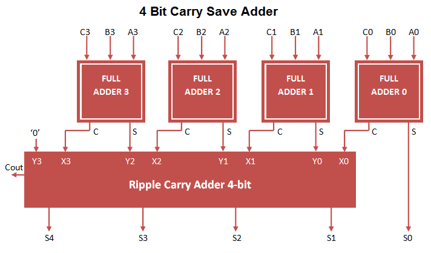
  <p><em>Figure 1: Architectural Block Diagram of a 4-Bit Carry-Save Adder with Vector Merging Stage.</em></p>
</div>

---

## 4. Hierarchical Design Methodology

The project adheres to a clean bottom-up full-custom VLSI design flow:

```
[Standard Cell Primitives]
 (Inverter, TG-AND, TG-OR, TG-XOR)
           │
           ▼
   [1-Bit Full Adder]
     (fa schematic & custom layout)
           │
           ▼
[4-Bit Modular CSA Block]
 (Rank 1 CSA + Rank 2 Vector Merge + Buffers)
           │
           ▼
[8-Bit Top-Level Carry-Save Adder]
 (Cascaded 4-bit blocks with Top-Level Layout)
```

---

### Level 0: Standard Cell Primitives (Transmission Gate Logic)

To minimize propagation delay and silicon real estate, logic gates were synthesized using **Transmission Gate (TG) CMOS Logic**. Transmission gates offer near-zero voltage degradation ($V_{DD}$ and $GND$ pass without threshold voltage drops $V_{th}$) and eliminate redundant transistor networks found in complementary static CMOS gates.

#### (A) CMOS Inverter
The fundamental building block used for generating complementary control signals.
- **Transistor Sizing**: PMOS $W/L = 2\,\mu\text{m} / 180\,\text{nm}$, NMOS $W/L = 2\,\mu\text{m} / 180\,\text{nm}$.
- **Layout Features**: Direct vertical poly routing, top $V_{DD}$ rail, bottom $GND$ rail in Metal 1.

| Schematic View | Custom Layout View |
| :---: | :---: |
| 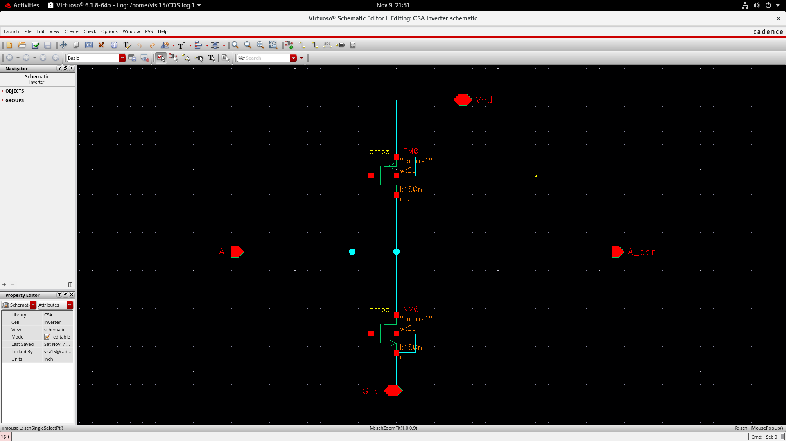 | 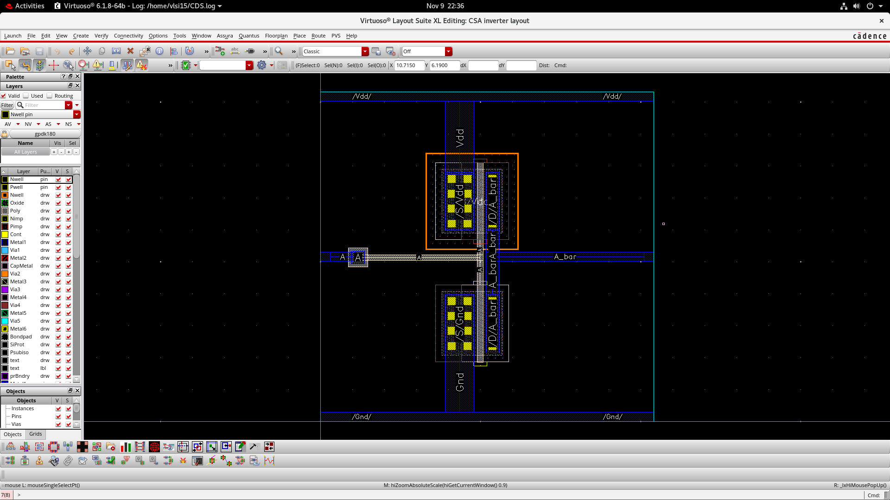 |

---

#### (B) Transmission Gate 2-Input AND Gate
Implemented using a complementary transmission gate multiplexer controlled by input $In2$, steering either $In1$ or $GND$ to the output.

| Schematic View | Custom Layout View |
| :---: | :---: |
| 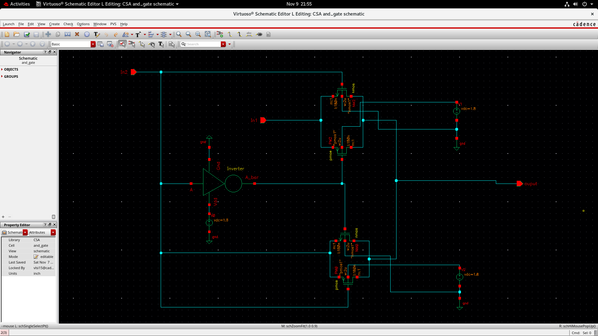 | 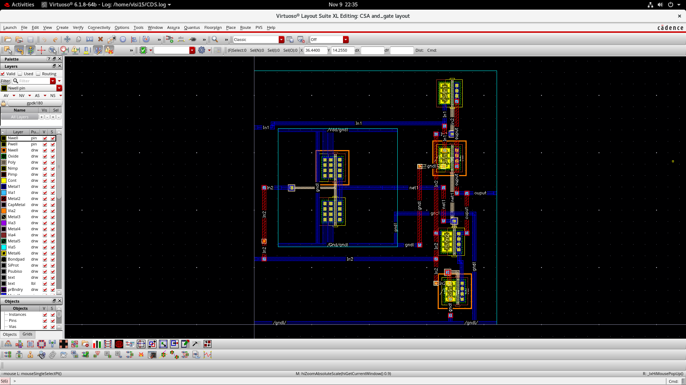 |

---

#### (C) Transmission Gate 2-Input OR Gate
Implemented using transmission gates to pass $In1$ or $V_{DD}$ depending on the control state of $In2$.

| Schematic View | Custom Layout View |
| :---: | :---: |
| 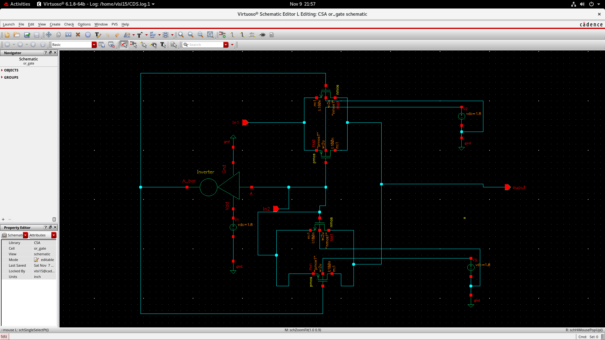 | 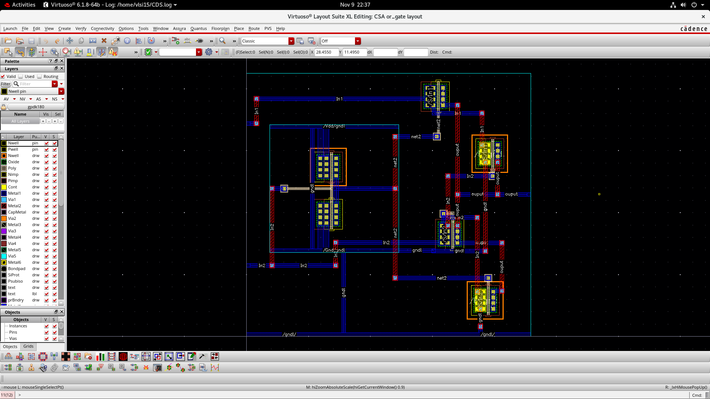 |

---

#### (D) Transmission Gate 2-Input XOR Gate
XOR is typically an expensive gate in static CMOS (requires 12 transistors). Using TG multiplexing, the XOR function is implemented with significantly fewer active transistors and symmetric transition slopes:

$$\text{Out} = In2 \cdot \overline{In1} + \overline{In2} \cdot In1$$

| Schematic View | Custom Layout View |
| :---: | :---: |
| 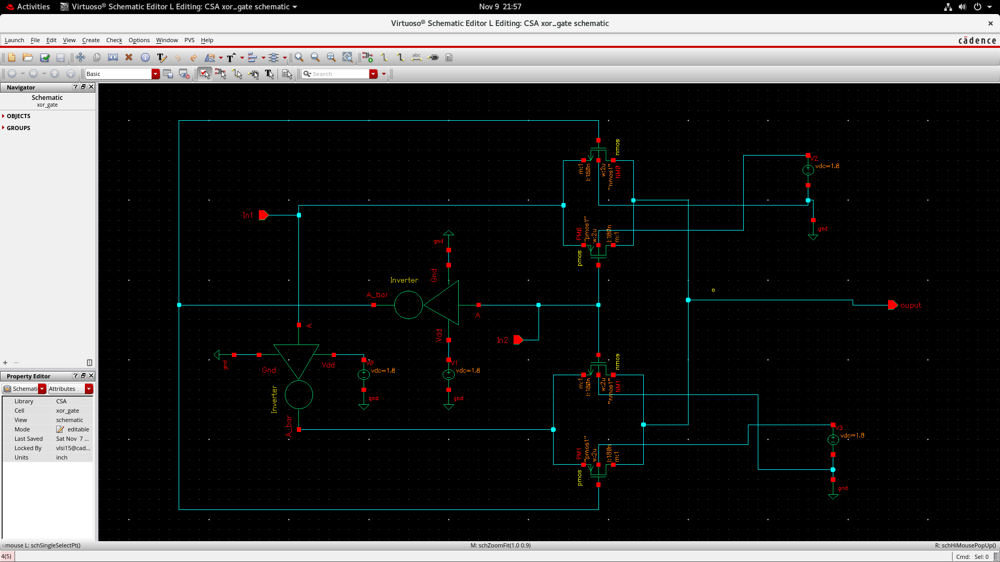 | 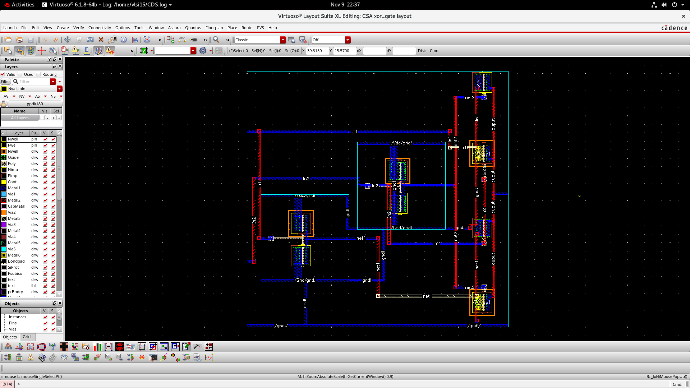 |

---

### Level 1: 1-Bit Full Adder

The 1-bit full adder combines:
- **Sum Generation**: Cascaded 2-input TG XOR gates:
  $$\text{Sum} = (A \oplus B) \oplus C$$
- **Carry Generation**: Two 2-input TG AND gates and one TG OR gate:
  $$\text{Carry} = (A \cdot B) + ((A \oplus B) \cdot C)$$

| Full Adder Schematic | Full Adder Custom Layout |
| :---: | :---: |
| 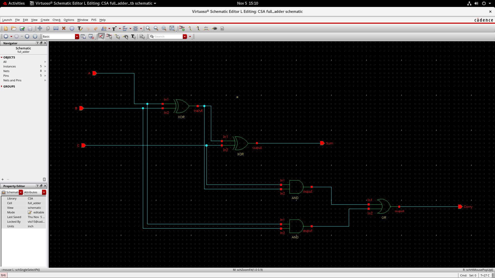 | 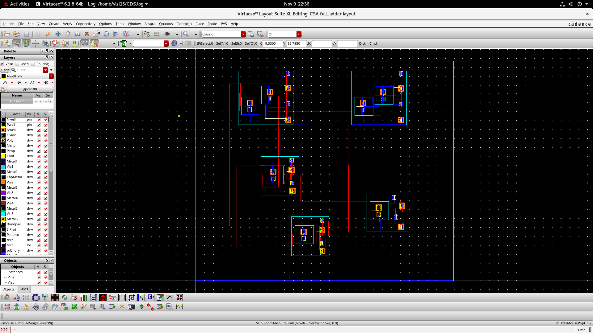 |

#### Full Adder Testbench & Verification Setup
A dedicated testbench was created with pulse voltage generators (`vpulse`) applying independent asynchronous clock pulses to inputs $A$, $B$, and $C$, with output buffer drivers (`BUFX1`) loaded at $\text{Sum}$ and $\text{Carry}$ outputs to test performance under realistic fan-out load conditions:

<div align="center">
  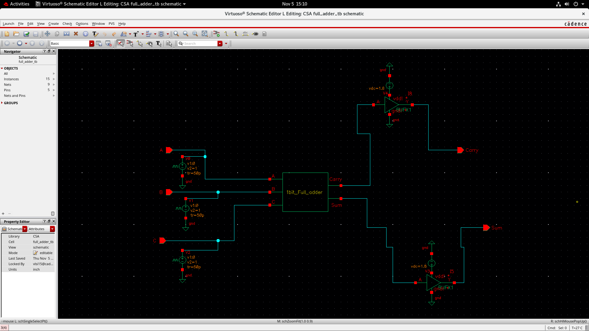
  <p><em>Figure 2: 1-Bit Full Adder Testbench with Output Buffer Stages.</em></p>
</div>

---

### Level 2: 4-Bit Modular Carry-Save Adder

The 4-bit CSA module accepts three 4-bit operand vectors ($A[3:0]$, $B[3:0]$, $C[3:0]$) and processes them in two stages:
1. **Rank 1 (Carry-Save Stage)**: Four 1-bit Full Adders operating concurrently to generate the intermediate sum and carry vectors.
2. **Rank 2 (Vector Merging Stage)**: Four Full Adders connected as a Ripple Carry Adder to resolve the saved carry bits into output bits $S[3:0]$, $S[4]$, and carry-out.

| 4-Bit CSA Schematic | 4-Bit CSA Custom Layout |
| :---: | :---: |
| 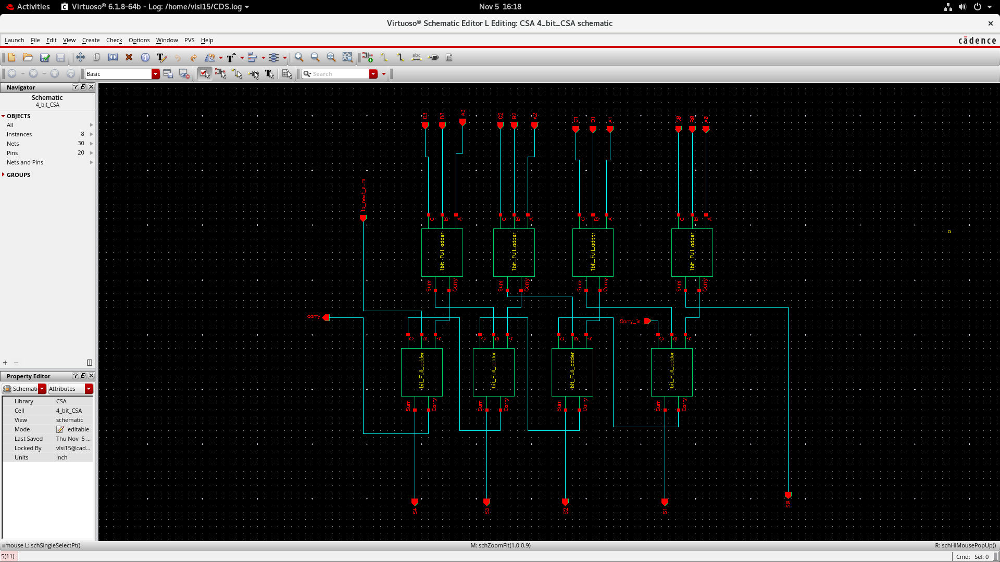 | 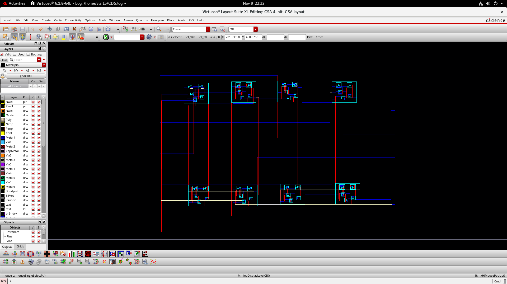 |

#### 4-Bit CSA Testbench
Simulated with realistic pulse inputs across all 12 input lines ($A_0-A_3, B_0-B_3, C_0-C_3$) buffered through standard cell inverters and buffers:

<div align="center">
  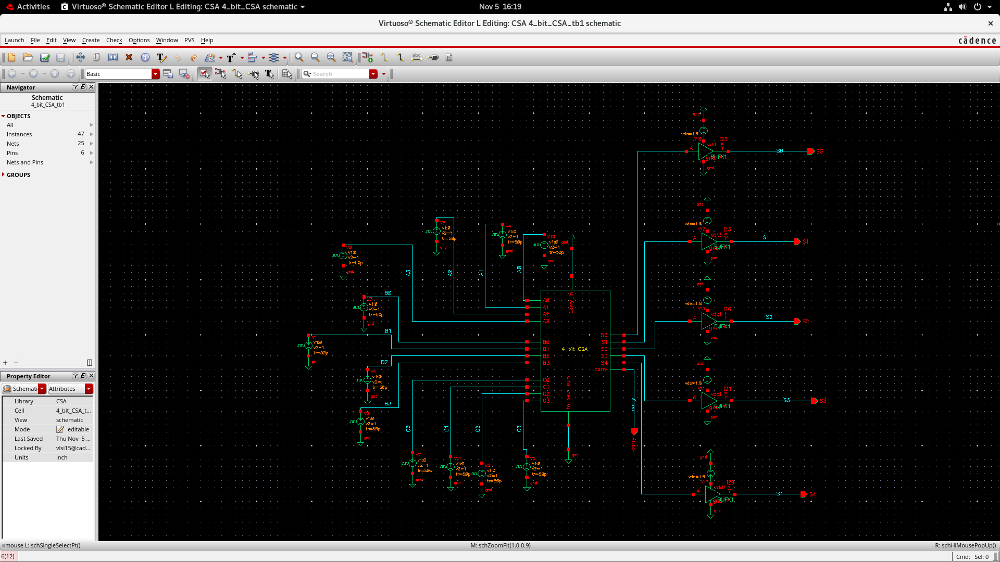
  <p><em>Figure 3: 4-Bit Carry-Save Adder Comprehensive Testbench.</em></p>
</div>

---

### Level 3: 8-Bit Top-Level Carry-Save Adder

The top-level architecture takes full 8-bit operands $A[7:0]$, $B[7:0]$, and $C[7:0]$. Two architectural views were explored:
1. **Flat Full-Adder Matrix**: A direct 16-Full Adder array linking bit slices $0$ to $7$.
2. **Hierarchical Cascaded CSA**: Cascading two verified 4-bit CSA blocks, routing the carry output and intermediate sums across the nibble boundary.

#### Hierarchical 8-Bit CSA (Cascaded 4-Bit CSA Blocks)
This modular implementation simplifies floorplanning, placement, and routing:

<div align="center">
  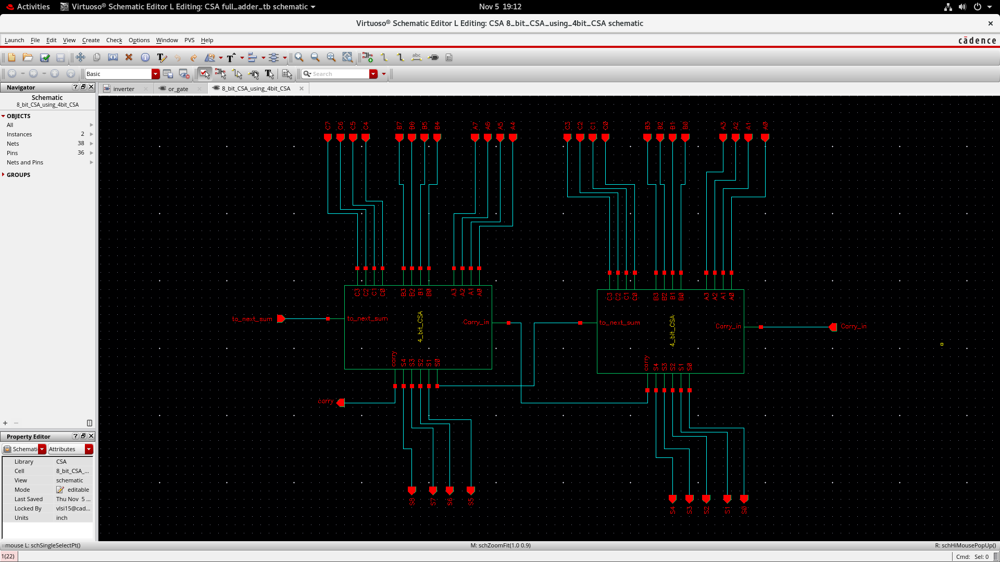
  <p><em>Figure 4: Hierarchical 8-Bit CSA Constructed by Cascading Two 4-Bit Modular CSA Blocks.</em></p>
</div>

#### Full Flat 8-Bit CSA Schematic
<div align="center">
  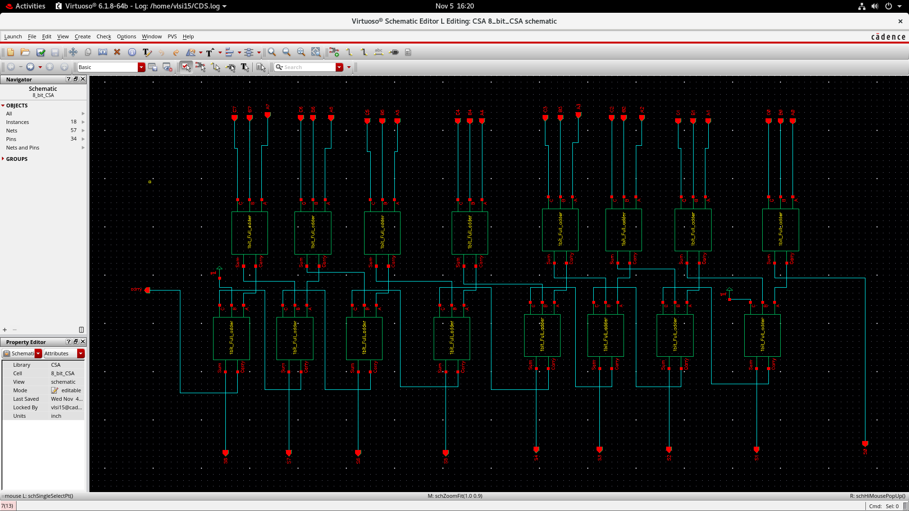
  <p><em>Figure 5: Transistor/Gate Matrix for Flat 8-Bit Carry-Save Adder.</em></p>
</div>

#### Top-Level 8-Bit Custom Layout
The top-level layout integrates the modular standard cells with global $V_{DD}$ and $GND$ distribution grids, inter-block routing across Metal 1 and Metal 2, substrate ties, and boundary cells.

<div align="center">
  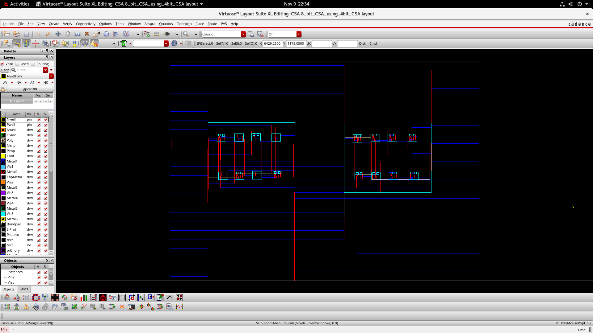
  <p><em>Figure 6: Full Custom Physical Layout of the 8-Bit Carry-Save Adder in Cadence Virtuoso Layout Suite XL.</em></p>
</div>

---

## 5. Physical Design & Custom Layout Flow

The physical design was developed using **Cadence Virtuoso Layout Suite XL**:
- **Layer Stack**: gpdk180 generic process technology (Single Poly, up to 6 Metal layers).
- **Metal Distribution**:
  - `Metal 1 (M1)`: Local intra-cell transistor interconnects, power and ground supply rails ($V_{DD}$ and $GND$).
  - `Metal 2 (M2)`: Inter-block signal routing, carry propagation lines, and external I/O pin ports.
  - `Poly`: Gate formation and local pass-gate connections.
- **Floorplanning & Pitch**: Consistent cell heights were maintained across all logic primitives to enable abutted power rails and compact silicon area.
- **Well & Substrate Taps**: N-well taps tied to $V_{DD}$ and P-substrate taps tied to $GND$ placed at regular intervals to prevent latch-up.

---

## 6. Physical Verification (DRC & LVS)

Physical verification was performed using **Assura 4.1**:

```
[Assura Physical Verification Flow]
          ┌────────────────┐
          │ GDSII / Layout │
          └───────┬────────┘
                  │
        ┌─────────┴─────────┐
        ▼                   ▼
 ┌──────────────┐   ┌──────────────┐
 │  Assura DRC  │   │  Assura LVS  │
 └──────┬───────┘   └──────┬───────┘
        ▼                  ▼
  [DRC: Clean]       [LVS: Matched]
 (0 Violations)     (0 Mismatches)
```

### Assura DRC (Design Rule Check)
The layout was verified against all foundry design rules:
- Poly minimum channel length ($L_{\text{min}} = 180\,\text{nm}$) and spacing.
- Metal 1 and Metal 2 minimum widths and spacing rules.
- Well-to-active spacings, enclosure of contacts, and antenna rules.
- **Rule Check Result**: 1379 rules checked $\rightarrow$ **0 Violations / Clean**.

### Assura LVS (Layout Versus Schematic)
The extracted layout netlist was cross-compared against the schematic netlist:
- Devices extracted: PMOS and NMOS transistor instances.
- Nets, terminals, and pins extracted and verified against schematic pin assignments.
- **Summary**:
  - **Net Mismatches**: 0
  - **Device Mismatches**: 0
  - **Pin Mismatches**: 0
  - **Parameter Mismatches**: 0
  - **Status**: **Matched (Schematic and Layout Match)**

---

## 7. Simulation Results & Waveform Analysis

The dynamic operation was verified through transient analysis in **Cadence Virtuoso Visualization & Analysis XL** using the **Spectre** simulation engine:

<div align="center">
  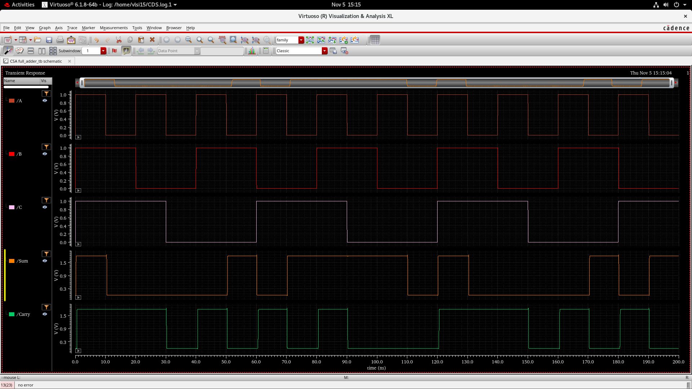
  <p><em>Figure 7: Spectre Transient Simulation Waveforms for Full Adder Operation across 200ns.</em></p>
</div>

### Waveform Analysis & Functional Correctness
- **Input Voltages**: Signals $/A$, $/B$, and $/C$ toggle between $0\,\text{V}$ (Logic '0') and $1.8\,\text{V}$ (Logic '1') with $50\,\text{ps}$ rise and fall times.
- **Truth Table Verification**:
  - When $A=0, B=0, C=0 \implies \text{Sum}=0\,\text{V}, \text{Carry}=0\,\text{V}$.
  - When single input is high ($A=1$ or $B=1$ or $C=1$) $\implies \text{Sum}=1.8\,\text{V}, \text{Carry}=0\,\text{V}$.
  - When two inputs are high ($A=1, B=1, C=0$) $\implies \text{Sum}=0\,\text{V}, \text{Carry}=1.8\,\text{V}$.
  - When all three inputs are high ($A=1, B=1, C=1$) $\implies \text{Sum}=1.8\,\text{V}, \text{Carry}=1.8\,\text{V}$.
- Clean transitions with negligible ringing or glitching, confirming the robustness of the transmission gate logic under buffered output loading.

---

## 8. Repository Directory Structure

```plaintext
DIC_mini_Project-JD/
├── README.md                          # Comprehensive documentation & portfolio overview
├── .gitignore                         # Tailored gitignore for Cadence/EDA temporary files
├── cds.lib                            # Cadence OpenAccess library mapping file
│
├── CSA/                               # Cadence OpenAccess (OA) Design Library
│   ├── inverter/                      # CMOS Inverter (schematic, symbol, layout)
│   ├── and_gate/                      # TG AND Gate (schematic, symbol, layout)
│   ├── and_gate_tb/                   # AND Gate Testbench
│   ├── or_gate/                       # TG OR Gate (schematic, symbol, layout)
│   ├── or_gate_tb/                    # OR Gate Testbench
│   ├── xor_gate/                      # TG XOR Gate (schematic, symbol, layout)
│   ├── xor_gate_tb/                   # XOR Gate Testbench
│   ├── full_adder/                    # 1-Bit Full Adder (schematic, symbol, layout)
│   ├── full_adder_tb/                 # Full Adder Testbench
│   ├── 4_bit_CSA/                     # 4-Bit Carry-Save Adder (schematic, symbol, layout)
│   ├── 4_bit_CSA_tb1/                 # 4-Bit CSA Testbench with ADE Spectre state
│   ├── 8_bit_CSA/                     # 8-Bit CSA Flat Schematic
│   ├── 8_bit_CSA_using_4bit_CSA/      # 8-Bit Hierarchical CSA (schematic, symbol, layout)
│   └── 8_bit_CSA_tb/                  # 8-Bit Top-Level CSA Testbench with ADE Spectre state
│
├── Obtained during DRC and LVS/       # Assura DRC and LVS reports and log files
│   ├── 8_bit_CSA_using_4bit_CSA.sum   # Assura DRC summary report
│   ├── 8_bit_CSA_using_4bit_CSA.log   # Assura DRC run log
│   ├── inverter.lrs                   # Assura LVS match report (0 mismatches)
│   └── *.lvsdb                        # Assura LVS debug databases
│
└── docs/
    └── assets/                        # High-resolution schematics, layouts, waveforms
        ├── csa_4bit_architecture.png
        ├── inverter_schematic.png
        ├── inverter_layout.png
        ├── and_gate_schematic.png
        ├── and_gate_layout.png
        ├── or_gate_schematic.png
        ├── or_gate_layout.png
        ├── xor_gate_schematic.png
        ├── xor_gate_layout.png
        ├── full_adder_schematic.png
        ├── full_adder_layout.png
        ├── full_adder_tb_schematic.png
        ├── full_adder_transient_waveform.png
        ├── csa_4bit_schematic.png
        ├── csa_4bit_layout.png
        ├── csa_4bit_tb_schematic.png
        ├── csa_8bit_flat_schematic.png
        ├── csa_8bit_hierarchical_schematic.png
        └── csa_8bit_layout.png
```

---

## 9. How to Open and Simulate in Cadence Virtuoso

### Prerequisites
- Cadence Virtuoso IC6.1.8 or higher
- Spectre Simulation Platform
- Assura 4.1 or PVS for physical verification
- Generic Process Design Kit 180nm (`gpdk180`)

### Setup Instructions
1. **Clone the Repository**:
   ```bash
   git clone https://github.com/<your-username>/8-Bit-Carry-Save-Adder-Cadence-180nm.git
   cd 8-Bit-Carry-Save-Adder-Cadence-180nm
   ```

2. **Configure `cds.lib`**:
   Ensure `cds.lib` points to your local workspace and foundry PDK:
   ```plaintext
   SOFTINCLUDE <path_to_your_cadence_installation>/cds.lib
   DEFINE gpdk180 <path_to_gpdk180_library>/gpdk180
   DEFINE CSA ./CSA
   ```

3. **Launch Cadence Virtuoso**:
   ```bash
   virtuoso &
   ```

4. **Simulate in ADE L / ADE XL**:
   - Open Library Manager (`Tools -> Library Manager`).
   - Select library `CSA`, cell `4_bit_CSA_tb1` or `8_bit_CSA_tb`, view `schematic`.
   - Launch ADE L (`Launch -> ADE L`).
   - Load the saved simulation state: `Session -> Load State -> state1`.
   - Click **Netlist and Run** to simulate transient waveforms in ViVA.

5. **Run DRC & LVS**:
   - From the Layout window (`8_bit_CSA_using_4bit_CSA -> layout`):
   - Navigate to **Assura -> Run DRC...**, select `gpdk180` technology rules.
   - Navigate to **Assura -> Run LVS...**, select the corresponding schematic view.

---

## 10. Author & Contact

Developed as part of a Digital Integrated Circuits (DIC) full-custom VLSI project.

- **Author**: VLSI Design & Verification Engineer
- **GitHub**: [@your-username]([https://github.com/your-username](https://github.com/dinesh-jonnalagadda))
- **LinkedIn**: [Connect on LinkedIn]([https://www.linkedin.com/](https://www.linkedin.com/in/dinesh-jonnalagadda-424451289/))

---

*If you found this project helpful for your learning or research in custom IC design and VLSI arithmetic, feel free to star this repository!*
